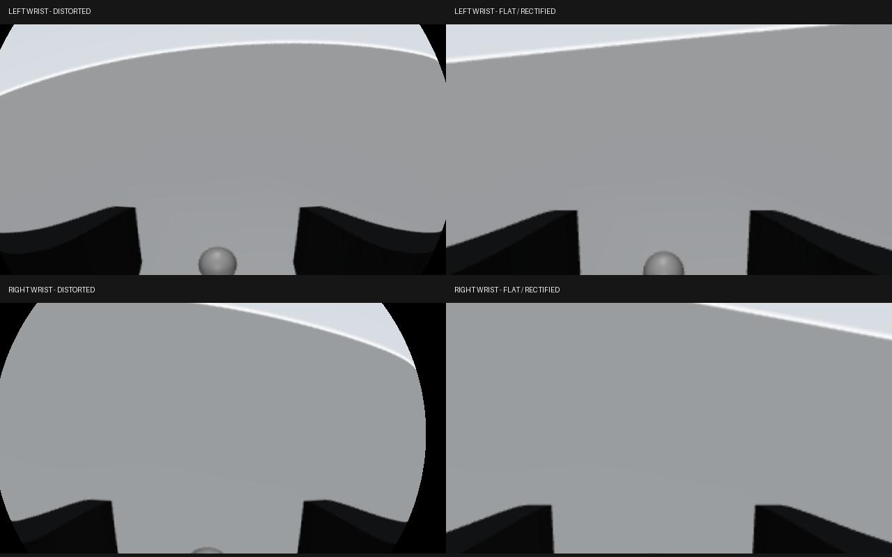

# Sophia Sim Assets

Finalized **Sophia sim v1.0.0** assets for MuJoCo training, real-to-sim trajectory replay, and staged sim-to-real evaluation.

The frozen baseline includes the supplied neck CAD, calibrated arm/neck reference frames, measured chassis and pillar dimensions, stereo-aligned base placement, and wrist cameras mounted above both grippers.

## Current default: flat wrist cameras

On `main`, both wrist cameras now output **flat, rectified pinhole images** by default, including Gymnasium `wrist_rgb` observations. The updated renderer is verified to produce a fully valid rectangular image for both wrists. Physical mounts, calibrated intrinsics, and the head ZED views are unchanged.

```python
rgb, depth, valid, metadata = camera.render(data, "left_wrist")
# To reproduce the previous calibrated distorted output:
rgb, depth, valid, metadata = camera.render(data, "left_wrist", raw=True)
```

```bash
python scripts/render_sophia_cameras.py --output output/flat-cameras
# Optional distorted output for matching raw robot recordings:
python scripts/render_sophia_cameras.py --raw-distorted --output output/raw-cameras
```

`--pinhole` remains a compatible explicit option. For sim-to-real policies trained on flat images, undistort real wrist frames using their calibration and the same output K/resolution. Use explicit `raw=True` for pipelines or checkpoints that require the previous distorted observation format.



This is working revision `1.0.1-dev`, based on the frozen v1.0.0 release below. All 17 targeted camera/environment/video tests pass. The original release archive, tag, and `RELEASE.json` remain unchanged. New camera regression results are in `release-evidence/rectified-wrist-defaults/`.

## Release

Download the [v1.0.0 release](https://github.com/adityx23/Sophia-Sim-Assets/releases/tag/v1.0.0) for the standalone ZIP, comparison video, checksums, and validation records.

- 23 acceptance check groups and 84 unit tests passed.
- The training task oracle succeeded in all three episodes.
- All 625 files in the standalone archive verified, and both models loaded and rebuilt in a clean temporary directory.
- Detailed validation and calibration records are in `release-evidence/` and [RELEASE.json](RELEASE.json).

## Setup and run

Use Python 3.11 on Linux with an EGL/OpenGL driver. From this repository:

```bash
python3.11 -m venv .venv-sophia
.venv-sophia/bin/python -m pip install --require-hashes -r requirements-sophia.txt
.venv-sophia/bin/python robot/yor_mujoco.py --model robot/yor-description/scene-sophia.mjcf
```

For offline acceptance, including the optional Gymnasium environment:

```bash
.venv-sophia/bin/python -m pip install --require-hashes -r requirements-sophia-training.txt
MUJOCO_GL=egl OPENBLAS_NUM_THREADS=1 .venv-sophia/bin/python scripts/check_sophia.py --training --render
```

The main model is `robot/yor-description/scene-sophia.mjcf`, with matching `sophia-ik.mjcf` and `sophia.json` configuration. [Asset documentation](docs/SOPHIA_SIM_ASSETS.md), [training](docs/SOPHIA_TRAINING.md), [replay](docs/SOPHIA_REPLAY.md), and [setup](docs/SOPHIA_OFFLINE_TOOLS.md) describe the interfaces and calibration scope. Historical replay requires the corresponding recordings; its height alignment is opt-in and file-hash-bound.

## Baseline scope

This release freezes the accepted geometry and software baseline. Contact/friction, payload dynamics and broader real-robot policy transfer retain the documented assumptions and validation limits. The release does not install or modify robot-side software. Record the version and archive checksum alongside training and replay runs, and use a new version for subsequent model changes.

`MANIFEST.json` covers this published source tree. The standalone release ZIP retains its original, independently verified manifest and checksum.
